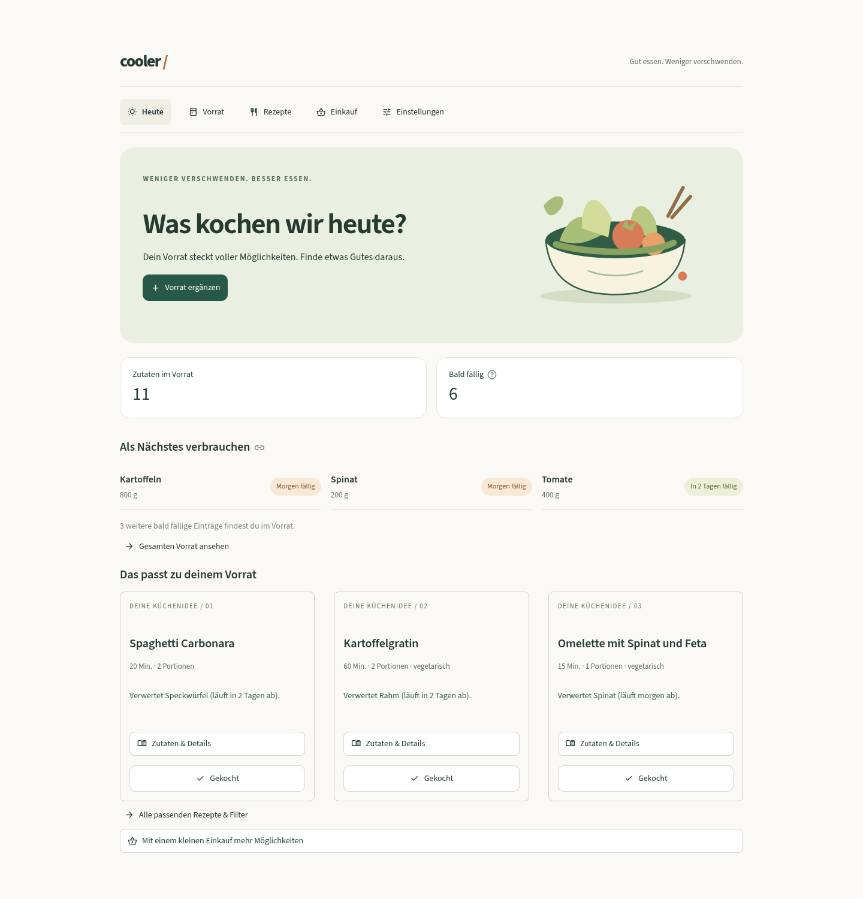

# App-Überarbeitung für TEST

Stand: 17. Oktober 2026. Aufgabenbranch `feature/app-redesign-test`, Ziel `test`.
Dieser Versuch wird ausdrücklich zuerst auf TEST veröffentlicht. `dev` und `main`
werden nicht verändert. Die fachlichen Regeln, das ML und die Rezeptdaten bleiben
auf ihrem bisherigen Stand.

## Bedienung und Gestaltung

- **Heute:** kompakter Einstieg, Vorratsanzahl, bald fällige Zutaten und drei
  passende Gerichte. Abgelaufene Einträge werden separat zur Prüfung angezeigt.
- **Vorrat:** Suche, Filter und pro Packung ein Bearbeitungsformular. Das
  Erfassungsformular ist bei gefülltem Vorrat zunächst eingeklappt. Menge,
  Einheit, Ablauf- und Öffnungsdatum bleiben bearbeitbar; Packungen bleiben getrennt.
- **Rezepte:** kompakte Karten, Details zum Aufklappen, Suche, vegetarischer
  Filter und maximale Kochzeit. Bei mehr als neun Treffern werden zunächst neun
  angezeigt. Vorhandene Zubereitungsschritte können angezeigt werden; fehlende
  Anleitungen werden nicht erfunden. Die bisherigen 18 Rezepte haben noch keine
  Schritt-für-Schritt-Zubereitung.
- **Einkauf:** persönliche Einkaufsliste. Eine Einkaufsidee verändert keinen
  Vorrat. Erst «Gekauft · in den Vorrat» übernimmt die tatsächlich gekaufte Menge,
  Einheit und das Datum. Wiederholte Klicks addieren keine Mengen. Übernahme und
  Entfernen aus der Liste erfolgen gemeinsam in einer Transaktion.
- **Einstellungen:** Grundstock, Profilwechsel und optionale Testszenario-Navigation.
- **Gestaltung:** warme helle Flächen, Grün als Akzent, gemeinsame Typografie,
  Abstände und Statusangaben mit Text. Eigene SVG-Illustration ohne externe
  Bildquelle. Keine zusätzlichen Frontend-Pakete oder Schriftabrufe.
- **Mobil:** einspaltige Formulare und Rezeptkarten, direkt sichtbare Navigation,
  grosse Schaltflächen und weiterhin native Tastaturbedienung.

## Datenzugriffe und Geschwindigkeit

Wissensbasis mit persönlichem Grundstock und Modellstatus werden innerhalb
eines vollständigen Seitenaufrufs einmal geladen. Jeder neue vollständige
Aufruf liest frisch. Persönliche Daten werden nicht global oder mit einer
zeitlichen Gültigkeitsdauer gecacht. Datenbankverbindungen werden nach der
Abfrage geschlossen, auch im Fehlerfall. Das vorhandene gemeinsame ML-Modell
bleibt wie bisher nach Anzahl Kochbewertungen gecacht.

Gemessen mit Python 3.12, Streamlit AppTest, lokalem SQLite und demselben
Beispielvorrat aus zehn Einträgen; jeweils drei warme Wiederholungen:

| Messung auf Heute | Vorher | Nachher |
|---|---:|---:|
| Datenbankverbindungen pro Aufruf | 12 | 4 |
| SQL-Aufrufe pro Aufruf | 12 | 4 |
| Lokale Laufzeit | 0.033–0.035 s | 0.030–0.037 s |

Damit sind die wiederholten Datenbankzugriffe um zwei Drittel reduziert. Lokal
ist kein belastbarer Geschwindigkeitsgewinn gemessen. Der Nutzen bei Turso hängt
von Netzwerklatenz und gehostetem Betrieb ab. Ein Streamlit-Kaltstart wird dadurch
nicht beseitigt. Die kommentierte Änderung an `requirements.txt` soll wie bei
bisherigen Releases einen frischen Cloud-Prozess auslösen; Paketversionen bleiben gleich.

## Datenbank und Kompatibilität

Die einzige Schemaergänzung ist `einkaufsliste` mit `id`, `person`, `zutat`,
`menge` und `einheit`. Die Tabelle wird automatisch angelegt. Bestehende Vorräte,
Grundstöcke und Bewertungen bleiben erhalten. Nicht wiederverwendete Einkaufs-IDs
verhindern, dass ein alter Dialog einen inzwischen neu angelegten Eintrag kauft.
Der bisherige Code kann mit dieser zusätzlichen Tabelle weiterhin arbeiten.

Mengenabzug und Kochbewertung bleiben atomar. Historischer Vorrats- und
Grundstockkontext sowie der Ausschluss von Vorab-Bewertungen bleiben erhalten.

## Prüfung

- **116 automatische Tests bestanden**, einschliesslich SQLite und lokalem libsql.
- Alle drei gespeicherten Vorratsszenarien bestanden.
- Neue Regressionstests für Einkauf planen/kaufen, doppelte Klicks, fremde
  Profile, Fehler mit Rollback, ungültige Mengen und veraltete Einkaufsdialoge.
- Oberflächentests für Anmeldung, Einheiten, Rezeptfilter, Vorratssuche und
  Ablaufstatus, Grundstock, Profilwechsel sowie Sterne und Restmengen.
- Ressourcenprüfung: wiederholte Grundstockzugriffe nutzen einen Kontext;
  Änderungen werden beim nächsten Aufruf sichtbar, Profile bleiben getrennt,
  Verbindungen werden auch bei Fehlern geschlossen.
- Browserprüfung und Screenshots mit Chromium bei Desktopbreite sowie 390 und
  320 Pixeln. Das ersetzt keinen Test auf einem physischen iPhone oder in Safari.
- Keine Produktionsdaten als Testziel verwendet. Browserbeispiele verwenden eine
  separate lokale Datenbank, keine echten Haushaltsdaten.

Automatisch wiederholen:

```bash
.venv/bin/python -m pytest -q
.venv/bin/python -m app.testszenarien
git diff --check
```

Manuell auf TEST prüfen: Profil öffnen, Zutat erfassen, Packung bearbeiten,
Rezeptdetails und Filter öffnen, Einkauf vormerken und nach dem Kauf übernehmen,
Gericht mit Sternen und Restmenge speichern. Bei altem UI nach dem Rollout den
Streamlit-Buildstatus prüfen und gegebenenfalls die TEST-App neu starten.

## Grenze vor einer öffentlichen Veröffentlichung

Die Oberfläche ist eine Projektvorschau. Profilnamen sind weiterhin **keine
Authentifizierung**. Die neue Anmeldung und die Einstellungen benennen das
ausdrücklich; ein Profilname in der URL öffnet kein Profil mehr. Vor einem
öffentlichen Kontobetrieb sind echte Anmeldung und verlässliche Zugriffsrechte
nötig. Das erfordert die Auswahl und Einrichtung eines Anmeldeverfahrens.

Weitere Arbeit vor einer allgemeinen Veröffentlichung: echte Zubereitungsschritte
und gegebenenfalls lizenzierte Rezeptbilder, Prüfung auf realen Mobilgeräten,
Messung der gehosteten Antwortzeiten sowie ein geklärter Daten- und Betriebsprozess.

## Ansichten mit lokalem Beispielvorrat



[Mobile Ansicht](bilder/heute-mobil.png). Die Beispiele enthalten ausschliesslich lokale Testdaten.
