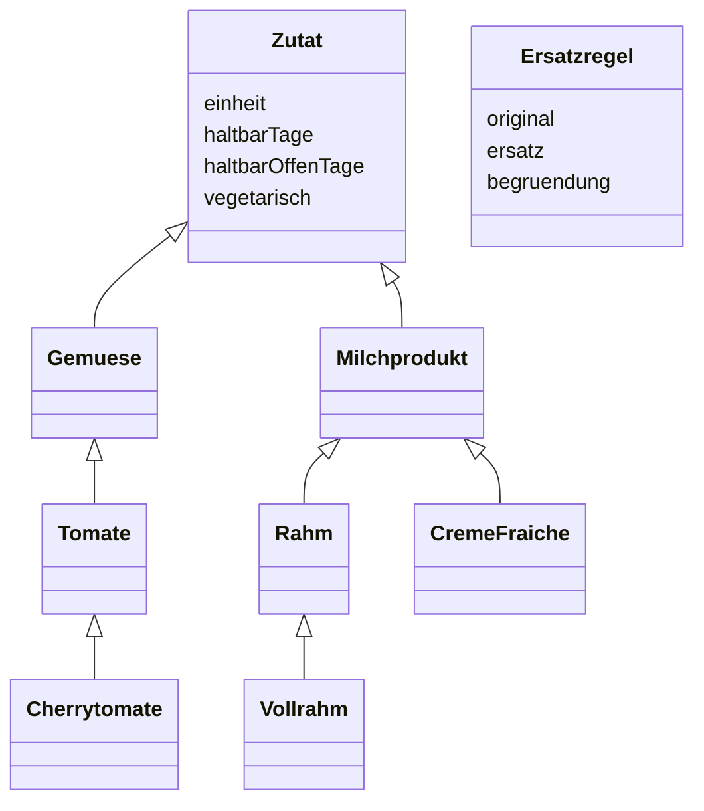
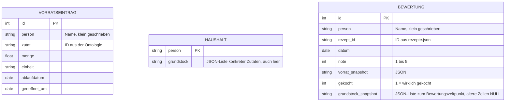

# Datenmodell

Die Daten liegen getrennt nach ihrer Art:

| Ort | Inhalt | Ändert sich |
|---|---|---|
| `wissensbasis/cooler_ai.ttl` (OWL) | Zutaten, Kategorien, Eigenschaften, Ersatzregeln | selten, per Pull Request |
| `daten/rezepte.json` | Rezepte mit Zutaten | selten, per Pull Request |
| `daten/testszenarien/*.json` | künstliche Vorräte, Stichtag, Grundstock und erwartete Rezept-IDs | per Pull Request |
| `cooler_ai.db` (SQLite, lokal) bzw. Turso (Test/Prod) | Vorrat, Haushalts-Grundstock, Bewertungen | laufend, wird nicht eingecheckt |

Verbunden sind sie über die **Zutat-ID** (lokaler Name der OWL-Klasse, z.B. `Cherrytomate`) und die **Rezept-ID** (z.B. `spaghetti_carbonara`).

## Ontologie



Ausschnitt; vollständig in `wissensbasis/cooler_ai.ttl`, Erklärung in `docs/wissensbasis.md`.

## Rezepte (`daten/rezepte.json`)

```json
{
  "id": "spaghetti_carbonara", "titel": "Spaghetti Carbonara", "kochzeit_min": 20, "portionen": 2,
  "zutaten": [
    {"zutat": "Spaghetti", "menge": 200, "einheit": "g", "pflicht": true},
    {"zutat": "Pfeffer", "menge": null, "einheit": null, "pflicht": true}
  ]
}
```

`zutat` darf auch eine Kategorie sein (`Teigwaren`), dann passt jede Unterart. `vegetarisch` wird nicht eingetragen, sondern aus der Ontologie abgeleitet.

## SQLite

Lokal eine Datei `cooler_ai.db`, in der Test- und Produktionsumgebung eine Turso-Datenbank (SQLite in der Cloud, gleiches Schema). Siehe `docs/deployment.md`.



## Hinweise

- **`person`**: Beim Öffnen der App gibt man seinen Namen ein (kein Passwort). Jede Person sieht nur ihren eigenen Vorrat. Bestehende Datenbanken bekommen die Spalte beim Start automatisch (`_ergaenze_spalte`); alte Einträge ohne Person sieht niemand mehr.

- **Effektives Ablaufdatum** = früheres von Etikett und Öffnungsdatum + `haltbarOffenTage` (`Wissensbasis.effektives_ablaufdatum`).
- **`VORRATSEINTRAG.einheit`**: Beim Erfassen wird die übliche Einheit aus der Ontologie vorgeschlagen. Sie lässt sich neben der Menge und später in der Vorratstabelle ändern (g, kg, ml, l, Stück bzw. ältere Stk-Einträge). Die eingegebene Menge gehört zur gewählten Einheit; in der Tabelle beide Werte gemeinsam anpassen. Beim Kochen werden vergleichbare Einheiten umgerechnet, inkompatible Einheiten verlangen eine manuelle Verbrauchsmenge.
- **`BEWERTUNG.vorrat_snapshot`** speichert den Vorrat zum Zeitpunkt der Bewertung als JSON (Zutat, Menge, Einheit, Tage bis Ablauf). Ohne ihn lassen sich die Trainingsmerkmale nicht rekonstruieren.
- **`BEWERTUNG.gekocht`** kam nachträglich dazu. `verbinde()` ergänzt die Spalte in bestehenden Datenbanken (Turso Test/Prod) automatisch.
- **Kochbewertungen**: Die 1–5 Sterne nach dem Kochen werden als ganze Zahl in `note` mit `gekocht = 1` gespeichert. Nur diese Datensätze gelangen ins ML-Training und in die Evaluation.
- **Historische Vorab-Bewertungen**: Alte Datensätze mit `gekocht = 0` oder ohne Kochbestätigung bleiben gespeichert, werden aber vollständig vom ML ausgeschlossen. Die Vorab-Eingabe und ihre Schreibfunktion sind entfernt. Es gibt keine neue Schemaänderung.
- Wird eine Zutat aus der Ontologie gelöscht, bleiben alte Vorratseinträge mit dieser ID stehen. Zutaten deshalb lieber umbenennen (`rdfs:label`) als die ID ändern.

## Grundstock und Testszenarien

`haushalt.grundstock` speichert pro Person eine explizite Zutatenliste. Eine leere Liste ist eine bewusste Auswahl; nur ohne gespeicherten Eintrag gilt die Standardliste. Änderungen beeinflussen Menüvorschläge, Einkaufsideen und auswählbare Vorratszutaten. Die gemeinsam geladene Ontologie wird dabei nicht geändert.

`bewertung.grundstock_snapshot` hält den damaligen Grundstock für Training und Evaluation fest. Bestehende Datenbanken erhalten die Tabelle `haushalt` und die optionale Spalte automatisch; ältere Bewertungen ohne Snapshot werden in App und CLI mit der bisherigen Standardliste ausgewertet.

Testszenarien liegen separat als JSON-Dateien. Sie enthalten konkrete Zutaten mit Menge, Einheit, Ablauf- und gegebenenfalls Öffnungsdatum sowie einen festen Stichtag, einen expliziten Grundstock und die erwarteten Rezept-IDs. Die Vorschau schreibt weder in Vorrat noch Bewertungen. Automatische Datenbanktests laden diese Szenarien nur in temporäre Datenbanken.
